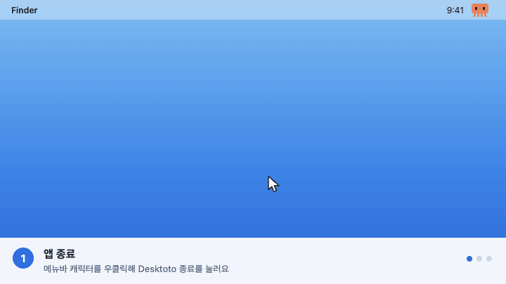
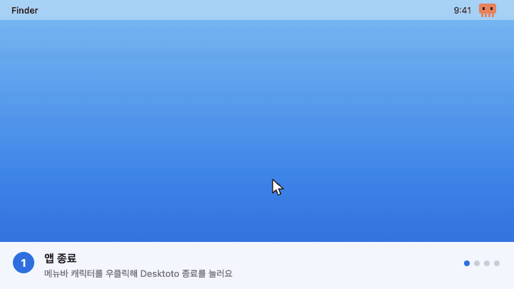

## 업데이트하는 방법

설치한 방법에 맞게 업데이트하세요. 앱의 우클릭 메뉴에 "새 버전이 있어요"가 보이면 새 버전이 나온 것입니다.

### 🍺 Homebrew로 설치했다면



```bash
brew upgrade --cask desktoto
```

### 💿 dmg로 설치했다면



> [!NOTE]
> Claude 연결은 다시 설정하지 않아도 돼요. 업데이트 뒤 권한을 다시 묻는 창이 뜨면 허용해 주세요.
> 처음 설치하는 방법은 [README](https://github.com/huniversal/Desktoto#readme)에 있어요.
