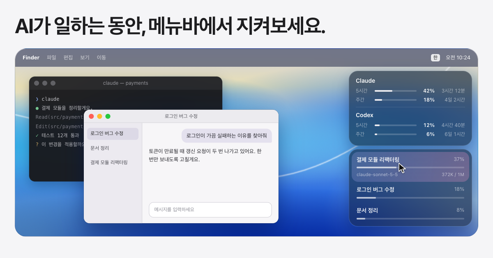

<h1 align="center">Desktoto</h1>

<p align="center">AI가 일하는 동안, 메뉴바에서 지켜보세요.</p>

<p align="center">
  
</p>

<p align="center">
  <a href="https://github.com/huniversal/Desktoto/releases"></a>
  <a href="https://github.com/huniversal/Desktoto/releases/latest"></a>
  
</p>

<p align="center">
  <a href="https://desktoto.pages.dev">랜딩 페이지</a> |
  <a href="https://github.com/huniversal/Desktoto/releases/latest/download/Desktoto.dmg">macOS용 다운로드</a>
</p>

Desktoto는 AI Agent(Claude Code, Codex) 세션의 진행 상태를 메뉴바의 작은 캐릭터로 보여줘요.
작업이 끝났는지, 내 답을 기다리는지 창을 열지 않고도 알 수 있어요.

## 설치

macOS 26 이상의 Apple Silicon Mac에서 쓸 수 있어요. Intel Mac은 지원하지 않아요.
Apple Developer 서명과 공증 없이 배포하는 앱이라 설치 방법에 따라 처음 실행할 때 경고가 나올 수 있어요.

### Homebrew로 설치

터미널을 쓴다면 Homebrew가 가장 편해요.

```bash
brew install --cask huniversal/tap/desktoto
```

설치하면서 다운로드 표시를 지워 주어서 처음 실행할 때 경고가 나오지 않아요. 새 버전은 `brew upgrade --cask desktoto`로 받고, 지우려면 `brew uninstall --cask desktoto`를 실행해요.

### dmg로 설치

1. [`Desktoto.dmg`](https://github.com/huniversal/Desktoto/releases/latest/download/Desktoto.dmg)를 받아 열고, `Desktoto`를 `응용 프로그램` 폴더로 끌어다 놓아요. 릴리스 페이지에는 압축 파일(`Desktoto-버전.zip`)도 있어요. zip은 압축을 풀고 나온 `Desktoto.app`을 `응용 프로그램` 폴더로 옮기면 돼요.
2. 처음 열면 개발자를 확인할 수 없다는 경고가 떠요. 창을 닫아요.
3. 시스템 설정, 개인정보 보호 및 보안 맨 아래에서 `그래도 열기`를 누르고 암호를 입력해요.
4. 다시 열면 메뉴바에 캐릭터가 나타나요.

터미널이 편하다면 이 명령으로 다운로드 표시를 지우고 경고 없이 열 수도 있어요.

```bash
xattr -dr com.apple.quarantine /Applications/Desktoto.app
```

처음 실행하면 로그인 시 자동 실행, 알림 보내기, Codex 연동, Claude 연동이 켜진 상태로 시작해요. 아이콘을 우클릭한 메뉴에서 언제든 끌 수 있어요.

## 왜 필요한가요

세션을 여러 개 돌리면, 놓치게 돼요.

- 다른 창에서 작업하다가, 끝난 지 한참 뒤에야 알게 돼요.
- 승인 창이 떠 있어서 AI가 멈춰 있는데, 그걸 모르고 기다려요.
- 컨텍스트가 얼마나 찼는지는 열어 보기 전에는 알 수 없어요.

## 캐릭터 상태

| 모습 | 뜻 |
| --- | --- |
| 달리는 중 | 작업이 진행 중이에요. 여러 세션 중 하나라도 돌고 있으면 계속 달려요. |
| 폭죽 | 작업이 끝났어요. 캐릭터 뒤에서 작은 폭죽이 터지고 macOS 알림이 와요. |
| 물음표 | 승인이나 답변이 필요해요. 사람을 기다리는 세션이 있으면 물음표가 떠요. |
| 보라색 점 | 확인하지 않은 완료가 있어요. 패널을 열어서 확인하면 사라져요. |
| 졸음 | 10분 동안 아무 활동이 없으면 캐릭터가 눈을 감고 졸아요. 새 작업이 시작되면 바로 깨요. |

## 기능

- **한 패널에 모든 세션**: 제목, 컨텍스트 사용률, 막대만 보여요. 모델과 토큰 수는 마우스를 올렸을 때만 펼쳐져요. 승인이나 답변이 필요한 세션은 맨 위로 올라와요. 서브 에이전트와 자동 리뷰 세션은 목록에서 제외해요.
- **AI 사용량도 한눈에**: Claude와 Codex의 5시간과 주간 한도를 패널 맨 위에 고정해서 보여줘요. 얼마나 썼는지와 초기화까지 남은 시간을 알 수 있고, 한도에 가까워지면 막대 색이 바뀌어요.
- **컨텍스트 사용률**: 모델마다 다른 컨텍스트 창 크기를 반영해서 사용률을 계산해요.
- **카드를 누르면 그 세션으로**: Claude 데스크탑 앱의 대화는 앱에서 열고, 터미널 세션은 iTerm2나 Terminal의 해당 탭을 앞으로 가져와요.
- **알림을 눌러도 이동해요**: macOS 알림으로 "작업이 끝났어요", "승인이 필요해요", "답변이 필요해요"를 알려 주고, 알림을 누르면 해당 세션으로 가요.
- **내 취향대로 꾸밀 수 있어요**: 아이콘을 우클릭하면 설정 메뉴가 열려요. 색상은 흰색과 컬러, 테마는 라이트와 다크와 시스템 설정에 맞춤 중에서 고를 수 있어요. Liquid Glass는 투명에서 틴트까지 5단계이고, 패널에는 사용량과 컨텍스트 중 보고 싶은 것만 띄울 수도 있어요.
- **새 버전 안내**: 새 버전이 나오면 우클릭 메뉴 맨 위에 안내가 나타나요. 앱 안에서 자동으로 내려받아 교체하지는 않고, Homebrew로 설치했다면 `brew upgrade --cask desktoto`를, 아니면 릴리스 페이지를 안내해요.

## 개인정보

내 대화는 컴퓨터 밖으로 나가지 않아요. Desktoto는 대화 내용을 인터넷에 보내지 않아요.
내 컴퓨터에 이미 있는 기록을 읽기만 하고, Codex 사용량만 Codex 프로그램에 물어봐요.

- **읽는 것**: `~/.claude/projects`와 `~/.codex/sessions`의 세션 기록, Claude 데스크탑 앱의 세션 정보, 앱이 내 컴퓨터에 임시로 저장해 둔 사용량 응답(5시간과 주간 사용률 두 가지 값만)을 읽어요. 제목, 모델, 토큰 사용량, 한도 사용률, 응답이 끝났는지 같은 상태만 써요. 로그인 정보는 읽지 않아요. Codex 사용량은 설치된 Codex 프로그램에 한도(사용률)만 물어봐요. 우클릭 메뉴에서 끌 수 있어요.
- **하지 않는 것**: 대화 내용을 밖으로 보내거나 따로 저장하지 않아요. 계정 정보도 다루지 않아요.
- **새 버전 확인**: 앱이 시작할 때와 이후 24시간마다 GitHub의 최신 릴리스 정보를 읽어요. 보내는 정보는 없고, 우클릭 메뉴의 업데이트 확인에서 끌 수 있어요.
- **설정 파일**: Claude Code를 쓰고 있으면, 처음 켤 때 `~/.claude/settings.json`에 항목 두 개(승인 대기를 알리는 hook과 사용량을 저장하는 statusLine)를 자동으로 추가해요. 이미 쓰는 statusLine은 그대로 실행돼요. 바꾸기 전에 백업을 만들고, 우클릭 메뉴의 Claude 연동에서 언제든 해제할 수 있어요.

## 알아 두세요

Desktoto는 수익을 목적으로 하지 않는 무료 프로젝트예요. 광고도, 결제도 없어요.
캐릭터는 Claude Code의 마스코트에서 영감을 받은 팬 작품이에요. Claude는 Anthropic의, Codex는 OpenAI의 상표이고, Desktoto는 두 회사의 공식 제품이 아니에요.
다운로드 배지는 `Desktoto.dmg`와 zip을 내려받은 횟수의 합이며, 사람 수가 아니에요.

---

## 개발자용

### 빌드와 실행

소스에서 빌드하려면 Xcode 26.6 이상(Swift 6, Swift Package Manager)이 필요하다. 저장소 루트에서 시작한다.

```bash
cd apps/macos
swift build
swift test
```

앱 번들을 만들고 실행한다.

```bash
cd apps/macos
sh scripts/build-app.sh
open build/Desktoto.app
```

`build-app.sh`는 릴리스 빌드, 번들 구성, 아이콘 생성, ad-hoc 서명과 검증까지만 한다. 다운로드한 앱은 처음 실행할 때 Gatekeeper 경고가 나오고 공증은 하지 않는다.

> 주의: `scripts/install-app.sh`는 `~/Applications/Desktoto.app`을 지우고 덮어쓴다. 원본 `ai-run` 앱이 같은 경로에 설치되어 있으면 번들 식별자가 달라 아무것도 지우지 않고 중단한다. 원본과 나란히 비교하는 동안에는 `build-app.sh`만 쓰고 `build/Desktoto.app`을 직접 연다.

앱은 Claude Code 연동(승인 대기 훅과 statusLine)을 처음 실행할 때 자동으로 켠다. `~/.claude`가 있으면 `~/.claude/settings.json`에 훅이 추가되고(변경 전 백업을 만든다), 이후 시작할 때 자동으로 연결한다. 우클릭 메뉴의 "Claude 연동"을 눌러 끄면 다시 넣지 않는다.

### 구조

```
apps/macos/Sources/
├── Domain/               값 타입과 모듈 사이 연결용 프로토콜
├── Boundaries/           파일, 프로세스, 시간, AppleScript, URL 경계(프로토콜과 실제 구현)
├── DesignSystem/         디자인 토큰과 공용 컴포넌트
├── SessionMonitoring/    기록 파일 탐색, 진행과 완료와 대기 판정, 컨텍스트 사용률
├── UsageMonitoring/      Claude와 Codex 사용량 수집
├── ClaudeIntegration/    Claude Code 설정의 훅과 statusLine 연결과 해제
├── TerminalIntegration/  터미널 프로세스 탐색, 탭 이동, 세션 열기
├── Preferences/          설정, 알림, 로그인 항목, 설정 메뉴 항목 모델
├── UpdateCheck/          새 버전 확인(최신 릴리스 조회, 버전 비교, 확인 주기, 설치 방식 판별)
├── MenuBarIcon/          캐릭터 격자, 프레임, 이미지
├── SessionPanel/         유리 패널 화면과 모델
├── CZstd/                벤더링한 zstd 해독부(C)
├── TestSupport/          테스트용 가짜 구현
└── Desktoto/             앱 진입점과 조립(감시 타이머, 알림, 세션 열기, 설정 메뉴)
```

기능 모듈끼리는 서로 import하지 않고 조립은 `Desktoto`만 한다. 자세한 규칙은 [아키텍처](docs/architecture.md)를 본다.

### 문서

- [아키텍처](docs/architecture.md), [디자인 시스템](docs/design-system.md), [CI와 릴리스](docs/ci.md)
- [원본 동작 기록](docs/reverse/overview.md): 모듈별 원본 동작과 원본과 달라진 점
- [작업 명세](docs/tasks): 이슈별 명세와 검증 기록
- [규칙](docs/rules): 코딩, Git, 작업 흐름, macOS 개발 기준
